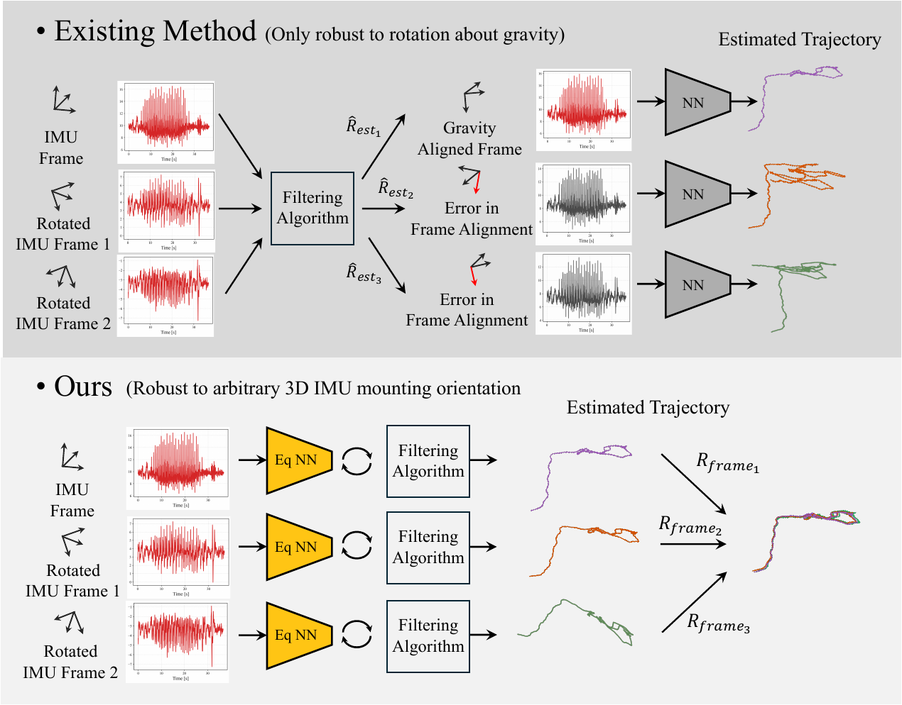
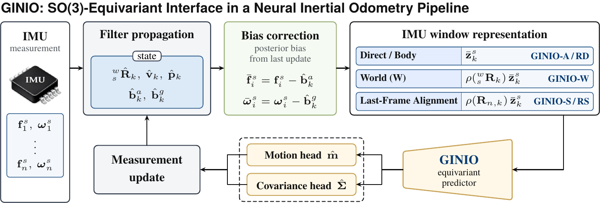
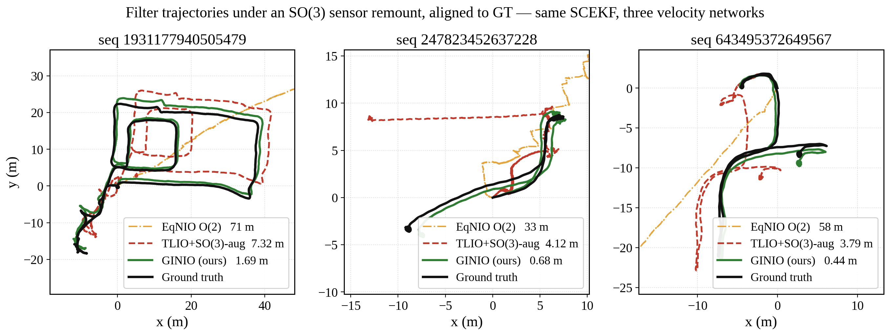
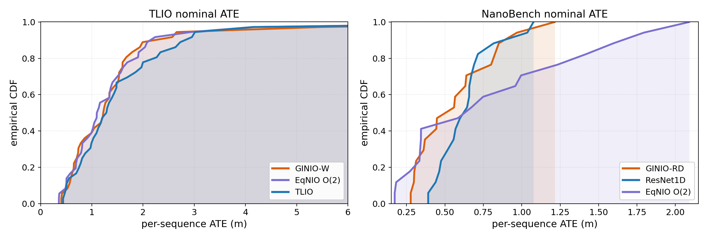

<div align="center">

<h1>GINIO: A Geometric SO(3)-Equivariant Interface for Neural Inertial Odometry</h1>

[**Chankyo Kim**](https://github.com/chankyo123)<sup>1</sup> · [**Minghan Zhu**](https://minghanz.github.io/)<sup>1</sup> · [**Tzu-Yuan Lin**](https://tzuyuan.github.io/)<sup>1</sup> · **Avantika Rattan**<sup>1</sup> · [**Maani Ghaffari**](https://name.engin.umich.edu/people/ghaffari-maani/)<sup>1</sup>

<sup>1</sup>University of Michigan, [CURLY Lab](https://curly.engin.umich.edu/)

**Conference on Robot Learning (CoRL) 2026 · Austin, TX**

[](https://openreview.net/forum?id=nl8iBTm3Mt)
[](https://arxiv.org/abs/2609.25338)
[](LICENSE)
[](environment.yml)
[](requirements.txt)
[](https://github.com/chankyo123/GINIO/releases)
[](https://github.com/chankyo123/GINIO/stargazers)
[](https://hits.sh/github.com/chankyo123/GINIO/)

[[`Paper & reviews`](https://openreview.net/forum?id=nl8iBTm3Mt)] [[`Model zoo`](#model-zoo)] [[`Data`](docs/DATA.md)] [[`Reproduce Table 2`](#quick-start)] [[`Known issues`](docs/KNOWN_ISSUES.md)] [[`BibTeX`](#citation)]



</div>

**TL;DR.** GINIO is an SO(3)-equivariant *interface* between an IMU window and the filter that
consumes it. Given a calibrated window, the network predicts a motion measurement whose **mean
transforms as a vector** and whose **covariance transforms congruently** (Σ ↦ RΣRᵀ) under any
rotation of the IMU measurement frame, by construction rather than by augmentation. The same
interface is instantiated on three backbones, Lie-Neuron ResNets, a Vector-Neuron version of the
AirIO recurrent model, and a full-SO(3) canonicalised EqNIO-style model, and evaluated on TLIO,
RIDI, NanoBench and a Fetch remounting set. Every released checkpoint ships with its SHA-256,
parameter count and the paper value it reproduces ([Model zoo](#model-zoo)).

> **Formerly `imu-equivariant-learning`.** This repository started in 2023 as a yaw-equivariant
> network-coupled inertial odometry code base. GINIO is the same project matured to full SO(3)
> equivariance with a covariance interface, now named after the CoRL 2026 paper. Old links
> redirect here; the last pre-GINIO snapshot is tagged
> [`imu-equivariant-learning-final`](../../releases/tag/imu-equivariant-learning-final).

## News

- **2026-10-18** — Code release: all three instantiations, the paper's evaluation scripts
  (`scripts/paper/`), 32 checkpoints with SHA-256 across TLIO / RIDI / NanoBench
  ([release `v1.0-corl2026`](../../releases/tag/v1.0-corl2026)), and the exact split lists
  (`splits/`). Repository renamed from `imu-equivariant-learning` to **GINIO**.
- **2026-10** — Camera-ready and [OpenReview page](https://openreview.net/forum?id=nl8iBTm3Mt)
  (reviews included) are public. GINIO is a **poster at CoRL 2026** (Nov 9–11, Austin).
- **Planned** — processed NanoBench split and the Fetch remounting set as a data release
  (pending the redistribution terms); the Fetch models and the AquaticVision evaluation could
  not be recovered from the original machines, see [`docs/KNOWN_ISSUES.md`](docs/KNOWN_ISSUES.md).

## What is in the box

<div align="center"></div>

| Suffix | Benchmark | What it is | Code | Released checkpoint |
|---|---|---|---|:---:|
| GINIO-W / GINIO-S | TLIO, RIDI (filter-connected) | world-frame / sensor-frame **Lie-Neuron ResNet** (`ln_resnet`) + SCEKF / InEKF | [`src/`](src/) | W: yes · S: no |
| GINIO-RD / GINIO-RS | NanoBench | `ln_resnet` with a diagonal / spectral covariance head | [`src/`](src/) | yes / yes |
| GINIO-R | Fetch remounting | `ln_resnet` | [`src/`](src/) | no (lost) |
| GINIO-A | NanoBench | **Vector-Neuron AirIO** recurrent model (VN-CNN + VN-GRU), with or without an attitude channel | [`airio/`](airio/) | yes |
| GINIO-E | NanoBench | full-SO(3) **canonicalised EqNIO-style** model | [`eqnio/`](eqnio/) | yes |

**Last-Frame Alignment (LFA)** expresses a window in the frame of its last IMU sample; for an
SO(3)-equivariant predictor it is provably equivalent to world-frame training (Appendix D). It is
implemented in [`src/dataloader/sequences_dataset.py`](src/dataloader/sequences_dataset.py) and
switched by the dataset path (`bodyframe` selects the sensor-frame branch, `nolfa` turns LFA off).
The standalone reference implementation is [`scripts/lfa_preprocessing.py`](scripts/lfa_preprocessing.py).

<div align="center"></div>

## Installation

```bash
git clone https://github.com/chankyo123/GINIO.git && cd GINIO
conda env create -f environment.yml && conda activate ginio
pip install torch torchvision --index-url https://download.pytorch.org/whl/cu124   # pick the wheel for your CUDA driver
```

Known-good versions, optional extras and gotchas: [`docs/INSTALL.md`](docs/INSTALL.md).

## Quick start

```bash
# 1. checkpoints (SHA-256 verified) — one benchmark or everything (~1.2 GB)
bash scripts/download_checkpoints.sh nanobench

# 2. data: TLIO golden / RIDI / NanoBench in the TLIO layout under local_data/  -> docs/DATA.md
#    (NanoBench: world-frame .npy + `python scripts/derive_body_npy.py` for the sensor-frame copy)

# 3. reproduce a Table-2 row with the released weights (NN-only, Umeyama ATE = `ate_um`)
python src/main_net.py --mode test --arch ln_resnet --body_frame True \
  --root_dir local_data/nanobench_bodyframe_nolfa_2nd_version --out_dir test_outputs/ginio_rd \
  --model_path checkpoints/nanobench_ginio_rd_t119/checkpoint_best.pt \
  --imu_freq 200 --imu_base_freq 1000 --window_time 0.775 --sample_freq 50 --batch_size 1024
#    GINIO-A rows + ID/SO(3) + equivariance / covariance-law errors:
cd airio && python -m evaluation.eval_idso3 --config configs/Nanobench/motion_body_noatt_vn_small.conf --n_rot 3

# 4. train one configuration (GINIO-RD recipe)
python src/main_net.py --mode train --arch ln_resnet --body_frame True \
  --root_dir local_data/nanobench_bodyframe_nolfa_2nd_version --out_dir models/ginio_rd \
  --epochs 170 --batch_size 256 --lr 5.44e-4 --weight_decay 2.41e-4 \
  --imu_freq 200 --imu_base_freq 1000 --window_time 0.775 --sample_freq 50 \
  --do_bias_shift --accel_bias_range 0.3878 --gyro_bias_range 0.0189 --nll_weight 1.0
```

Full command sheets for the three families, the filter chains (SCEKF / InEKF), the attitude-error
sweep and the frozen-mean covariance study: [`docs/TRAIN_EVAL.md`](docs/TRAIN_EVAL.md).
Scripts that regenerate the paper's tables and figures: [`scripts/paper/README.md`](scripts/paper/README.md).
A one-minute CPU self-check of the equivariance machinery: `cd airio && python -m model.test_a2_spectral_equivariance` (24 checks).

## Model zoo

Checkpoints are assets of the [`v1.0-corl2026` release](../../releases/tag/v1.0-corl2026), one
archive per benchmark plus [`paper_results.tar.gz`](../../releases/download/v1.0-corl2026/paper_results.tar.gz)
(the stored outputs behind every "reproduced" value) and a `SHA256SUMS` file;
`bash scripts/download_checkpoints.sh` fetches and verifies them. The table lists the rows that
back printed numbers; [`checkpoints/MANIFEST.md`](checkpoints/MANIFEST.md) is the source of truth
for all 32 folders, hashes, parameter counts, loader notes and the 18 traps you should read before
loading anything. Table numbers follow the camera-ready PDF.

| Paper row | Folder | Family / registry key | Params | Paper → reproduced | Status |
|---|---|---|---:|:---:|---|
| Table 1 TLIO GINIO-W | `tlio_ginio_w_ln189` | `src/` · `ln_resnet` (two weight sets, see MANIFEST) | 0.57M | 1.615 → 1.615 (ID/ID) | PINNED / ID-SO(3) CKPT_ONLY |
| Table 1 TLIO EqNIO | `tlio_eqnio_o2` | `eqnio/` · `eq_o2_frame_fullCov_2vec_2deep` | 6.02M | 1.554 → 1.554 · 76.389 → 76.39 | PINNED |
| Table 1 TLIO ResNet+SCEKF+aug. | `tlio_resnet_so3aug` | `src/` · `resnet` | 5.42M | 1.844 → 1.842 | CKPT_ONLY |
| Table 1 TLIO ResNet+SCEKF | `tlio_resnet_scekf_retrain2026` | `src/` · `resnet` (2026 retrain) | 5.42M | 1.725 → 1.746 | RETRAIN |
| Table 1 TLIO ResNet-S+InEKF | `tlio_resnet_s_lfa_candidate` | `src/` · `resnet`, LFA | 5.42M | 2.814 → 2.876 | CKPT_ONLY |
| Fig. 5(b) covariance arms | `tlio_fig5b_spec_s0v2`, `tlio_fig5b_diag_s0v2` | `src/` · `ln189_speccov_s0`, `ln189_speccov_s0_diag` | 1.38M | 1.081 / 1.072 → same | PINNED |
| Table 1 RIDI GINIO-W, Sec. 4.2 NN-only | `ridi_ginio_w` | `src/` · `ln_resnet_slope1_nobias` | 0.57M | 0.927 → 0.927 (NN); filter cells not reproduced | PINNED / CKPT_ONLY |
| Table 1 RIDI "EqNIO" (SO(3)-aug.) | `ridi_eqnio_o2_so3aug` | `eqnio/` · `eq_o2_frame_fullCov_2vec_2deep` | 6.02M | 2.408 → 2.408 | PINNED / ID-SO(3) CKPT_ONLY |
| Table 1 RIDI ResNet+SCEKF+aug. | `ridi_resnet_so3aug` | `src/` · `resnet` | 5.42M | 1.401 → no stored output | CKPT_ONLY |
| Table 2 AirIO (no-att. / with-att.) | `nanobench_airio_noatt`, `nanobench_airio_withatt` | `airio/` · `codenetmotion`, `codewithrot` | 0.33M / 0.39M | 5.579 → 5.5785 · 1.205 → 1.2049 | PINNED |
| Table 2 GINIO-A (no-att. / with-att.) | `nanobench_ginio_a_noatt`, `nanobench_ginio_a_withatt` | `airio/` · `vn_codenetmotion_small`, `vn_codewithrot_small` | 0.045M | 1.430 → 1.4302 · 1.045 → 1.0453 | PINNED |
| Table 2 ResNet1D | `nanobench_resnet1d` | `src/` · `resnet` | 5.43M | 0.645 → 0.6455 | PINNED |
| Table 2 EqNIO O(2) | `nanobench_eqnio_o2` | `eqnio/` · `eq_o2_frame_fullCov_2vec_2deep` (NanoBench-trained) | 6.03M | 0.828 → 0.8282 | PINNED |
| Table 2 GINIO-E | `nanobench_ginio_e_so3aug_tlio` | `eqnio/` · `eq_so3_frame_fullCov_2vec_2deep` (TLIO-trained, zero-shot) | 6.03M | 0.785 → 0.7854 | PINNED |
| Table 2 GINIO-RD | `nanobench_ginio_rd_t119` | `src/` · `ln_resnet` (0.775 s window, no LFA) | 0.54M | 0.581 → 0.5805 | PINNED |
| Table 2 GINIO-RS | `nanobench_ginio_rs_chol_mse` | `src/` · `ln_resnet_chol` (trained **without** LFA) | 0.80M | 0.789 → 0.7887 | PINNED (label caveat) |
| Table 8 covariance ablation | `nanobench_ginio_rd_lfa_{mse,nll}`, `nanobench_ginio_rs_chol_{mse,nll}` | `src/` · `ln_resnet`, `ln_resnet_chol` | 0.57M / 0.80M | all cells reproduce except Spectral/NLL NLL and NEES | PINNED / UNSUPPORTED |
| Table 9 NanoBench aug. baselines | `nanobench_resnet1d_so3aug`, `nanobench_eqnio_o2_so3aug` | `src/` · `resnet`; `eqnio/` | 5.42M / 6.02M | sweeps measured, printed values differ | CKPT_ONLY |

Not in the table but released as controls or references: `tlio_eqnio_o2_ours`, `ridi_eqnio_o2_noaug`,
`ridi_resnet_epoch1`, `ridi_imunet_reimpl`, `nanobench_airio_*_serverb`, `nanobench_ginio_rd_t55`,
`nanobench_ginio_rd_nolfa_nll_matched`. **Not released because nothing survives:** the Fetch models
(Tables 10–12), AquaticVision (Table 13), GINIO-S on TLIO/RIDI, the RIDI ResNet+SCEKF model, the
Table 2 ID/SO(3) generator for the non-equivariant rows, and the 0.273M GINIO-A originals of
Table 4 (they no longer load strictly). Details and evidence: [`checkpoints/MANIFEST.md`](checkpoints/MANIFEST.md),
[`docs/PAPER_ARTIFACT_MAP.md`](docs/PAPER_ARTIFACT_MAP.md), [`docs/KNOWN_ISSUES.md`](docs/KNOWN_ISSUES.md).

## Data

All loaders read the TLIO layout (one folder per sequence with `imu0_resampled.npy`,
`calibration.json`, description JSON; split lists at the dataset root) under `local_data/`. The exact
train / val / test lists are committed in [`splits/`](splits/). Sources, conversions and caveats
(including that the processed NanoBench accelerometer has gravity removed): [`docs/DATA.md`](docs/DATA.md).

| Dataset | Used in | Source |
|---|---|---|
| TLIO golden (CC BY-NC) | Table 1, Tables 5–7, Fig. 5 / 11 / 12 | [CathIAS/TLIO](https://github.com/CathIAS/TLIO) release |
| RIDI | Table 1, Table 9 | [RIDI `data_publish_v2`](https://github.com/higerra/ridi_imu) + `scripts/ridi/` converters |
| NanoBench (Crazyflie 2.1, Vicon) | Table 2, Tables 4 / 8 / 9, Figs. 8–11 | [NanoBench](https://arxiv.org/abs/2603.09908); our 100 Hz world-frame conversion + `scripts/derive_body_npy.py` |
| Fetch remounting (ours) | Tables 10–12, Figs. 13–14 | `fetch_dataset.zip` in the CoRL supplement (69 sequences) |

<div align="center"></div>

## Reproducibility notes

Three things to know before comparing numbers; everything else is in
[`docs/EVAL_PROTOCOL.md`](docs/EVAL_PROTOCOL.md) and the MANIFEST traps.

* **Metrics.** Table 2 reports the Umeyama-aligned (rotation + translation, no scale) position RMSE
  after integrating the predicted body velocity through ground-truth attitude (`ate_um`); the
  TLIO-style `ate` in `metrics.json` is an unaligned mean error and not comparable. Table 1 mixes two
  filter metric codes (TLIO-metric vs EqNIO-metric); the MANIFEST says which one each value used.
* **ID/SO(3).** Rotate IMU channels and vector targets by the same `R`, transform covariance targets
  by `RΣRᵀ`, un-rotate predictions. `airio/evaluation/eval_idso3.py` and
  `--test_perturb_type so3` implement this; both equivariant families are unchanged under any
  rotation by construction (≤ 5e-9 relative for the attitude-free GINIO-A). The with-attitude GINIO-A
  is equivariant only when its attitude channel is rotated like the other vectors.
* **Checkpoint selection.** `airio/train_motion.py` (upstream AirIO behaviour) selects
  `best_model.ckpt` on the config's `test` block, which for NanoBench is the reported 17-sequence
  test split, for AirIO baselines and GINIO-A alike; the RIDI `val_list` equals its `test_list`.
  No rotation augmentation is used for any paper model.

Discrepancies between the camera-ready and the surviving evidence (for example the Table 8
Spectral/NLL NLL and NEES cells, and the GINIO-RS "body+LFA" label) are listed with file-level
evidence in [`docs/KNOWN_ISSUES.md`](docs/KNOWN_ISSUES.md); we will keep that page and the
OpenReview thread in sync.

## Repository layout

```text
GINIO/
├── src/                    Lie-Neuron family (GINIO-W/S/RD/RS/R): training, test, SCEKF / InEKF trackers   [TLIO-derived]
├── airio/                  Vector-Neuron AirIO family (GINIO-A) and the AirIO baselines; run from inside   [Air-IO-derived]
├── eqnio/TLIO-master/      canonicalised family (GINIO-E) and the EqNIO O(2) baseline                        [EqNIO-derived]
├── scripts/
│   ├── download_checkpoints.sh   release assets + SHA-256 verification
│   ├── paper/                    scripts behind the paper's tables and figures (see its README)
│   ├── export/  ridi/            TorchScript exports with full covariance; RIDI -> TLIO-layout converters
│   ├── derive_body_npy.py  lfa_preprocessing.py  run_test_all.sh  run_sweep*.sh  run_finetune.sh
│   └── provenance/               diffs of the forks behind the ledger-only Table 1 / 6 / 7 numbers
├── checkpoints/MANIFEST.md        model zoo: every released checkpoint, hash, loader note, status, traps
├── docs/                   INSTALL · DATA · TRAIN_EVAL · EVAL_PROTOCOL · FILTER_EVALUATION · KNOWN_ISSUES · PAPER_ARTIFACT_MAP · RELEASE_LAYOUT
├── splits/                 exact train / val / test lists (TLIO, RIDI, NanoBench)
├── assets/                 figures used in this README
├── CITATION.cff · LICENSE · THIRD_PARTY_NOTICES.md · CONTRIBUTING.md · environment.yml · requirements.txt
```

The three families are modified copies of three upstreams with their own config systems, so they
live in three subfolders (the way EqNIO ships `TLIO-master/` and `RONIN/`).

## License

Code written for GINIO is released under the [MIT License](LICENSE). The repository contains
modified copies of [TLIO](https://github.com/CathIAS/TLIO) (BSD), [AirIO](https://github.com/Air-IO/Air-IO)
(BSD-3-Clause), [Vector Neurons](https://github.com/FlyingGiraffe/vnn) (MIT),
[Lie Neurons](https://github.com/UMich-CURLY/LieNeurons) (BSD-3-Clause) and
[EqNIO](https://github.com/RoyinaJayanth/EqNIO) (no license file upstream; redistributed for
research reproduction, see [`THIRD_PARTY_NOTICES.md`](THIRD_PARTY_NOTICES.md)); their terms apply to
the corresponding files. Datasets are not redistributed. The checkpoints inherit the license of the
data they were trained on (TLIO golden is CC BY-NC).

## Acknowledgements

GINIO grew out of the public TLIO code base and would not exist without the groups who released
theirs: TLIO, EqNIO, AirIO, Vector Neurons and Lie Neurons (same lab). If we have missed an
attribution, please open an issue and we will fix it. Related repositories from our group:
[LieNeurons](https://github.com/UMich-CURLY/LieNeurons).

## Citation

GINIO is equivariant to rotations but not invariant to stars: if the code or the checkpoints helped
your work, a ⭐ genuinely changes our output, and please cite the paper.

```bibtex
@inproceedings{kim2026ginio,
  title     = {{GINIO}: A Geometric {SO(3)}-Equivariant Interface for Neural Inertial Odometry},
  author    = {Kim, Chankyo and Zhu, Minghan and Lin, Tzu-Yuan and Rattan, Avantika and Ghaffari, Maani},
  booktitle = {Proceedings of The 10th Conference on Robot Learning (CoRL)},
  year      = {2026},
  url       = {https://openreview.net/forum?id=nl8iBTm3Mt}
}
```

<div align="center">

[](https://star-history.com/#chankyo123/GINIO&Date)

</div>
